<picture>
  <source media="(prefers-color-scheme: dark)" srcset="assets/wordmark-dark.svg">
  <source media="(prefers-color-scheme: light)" srcset="assets/wordmark-light.svg">
  
</picture>

<picture>
  <source media="(prefers-color-scheme: dark)" srcset="assets/header-dark-animated.svg">
  <source media="(prefers-color-scheme: light)" srcset="assets/header-light-animated.svg">
  
</picture>

  <a href="#about">About</a> &nbsp; / &nbsp;
  <a href="#toolbox">Toolbox</a> &nbsp; / &nbsp;
  <a href="#selected-work">Selected work</a>

## About

I'm **Gamal Khaled**, also known as **Desperado** — a backend .NET developer focused on APIs, ERP systems, and maintainable business software.

I enjoy turning complex business rules into clear domain models. My interests include modular architecture, domain-driven design, and practical performance improvements.

## Toolbox

`C#` &nbsp; `.NET` &nbsp; `ASP.NET Core` &nbsp; `EF Core` &nbsp; `SQL Server` &nbsp; `Git` &nbsp; `Docker`

| Area | Focus |
| :--- | :--- |
| **Backend** | REST APIs, data access, and business logic |
| **Architecture** | Modular monoliths, DDD, and CQRS |
| **Code quality** | SOLID, composition, and refactoring |
| **Performance** | Collections, lazy enumeration, and measurement |

## Selected work

A few public examples of how I approach software design and C#.

| Project | Inside |
| :--- | :--- |
| **[Refactoring & Modern C# ↗](https://github.com/iTz-DESPERADO/iTz-DESPERADO-OOP-Assignment-3/tree/assignment/1-7/submission/assignment)** | Strategy, dependency injection, Decorator, Facade, collections, and generics. |
| **[Design Patterns & SRP ↗](https://github.com/iTz-DESPERADO/iTz-DESPERADO-OOP-Assignment-2/tree/assignment/1-6/submission/assignment)** | Singleton, Prototype, Builder, and refactoring responsibilities into focused classes. |
| **[Domain Modeling in C# ↗](https://github.com/iTz-DESPERADO/iTz-DESPERADO-OOP-Assignment-1/tree/assignment/1-5/submission/assignment)** | Order and hotel reservation models, value objects, and composed builders. |

  <a href="https://github.com/iTz-DESPERADO?tab=repositories">Browse repositories →</a>

---

  Clear models. Explicit rules. Maintainable code.

